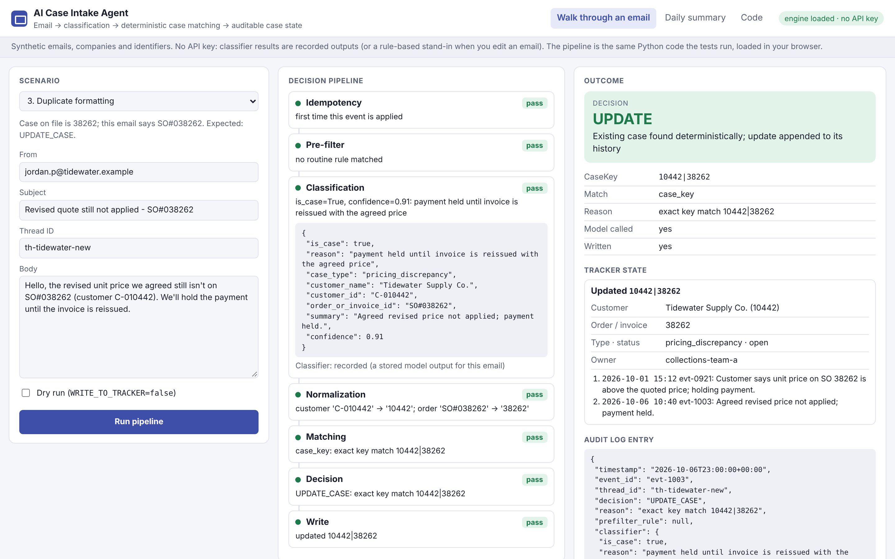
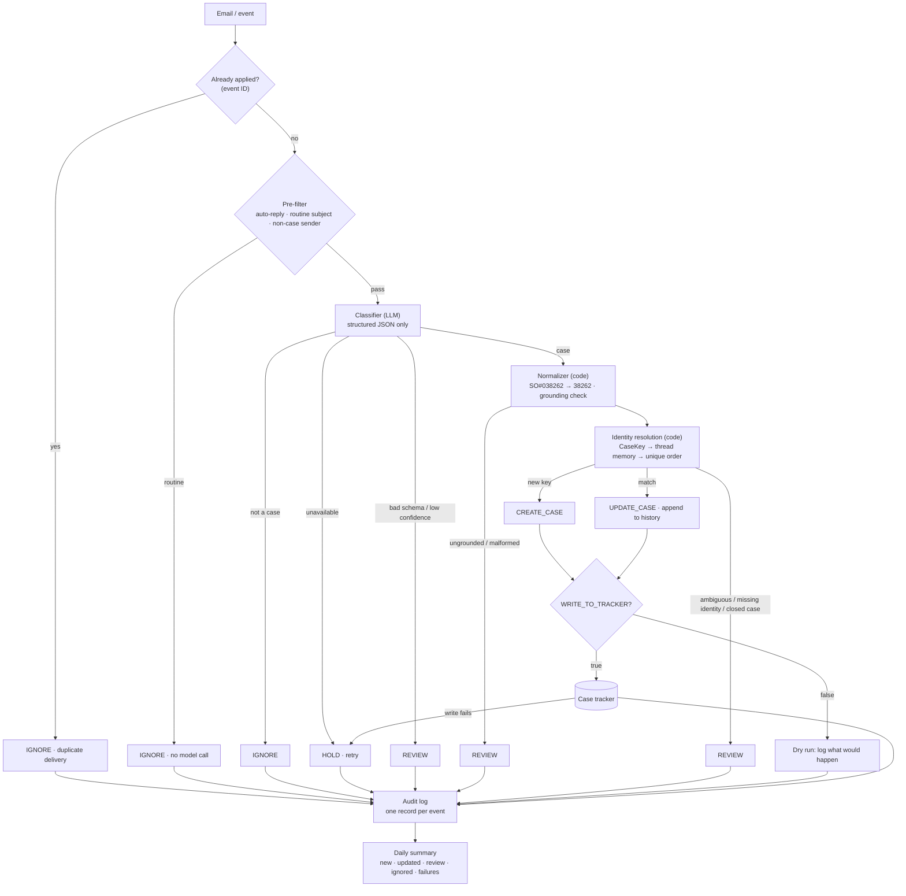

# AI Case Intake Agent

**Email → classification → deterministic case matching → auditable case state**

**[Live Demo](https://vrutikadani.github.io/ai-case-intake-agent/)** · [Architecture](docs/architecture.md) · [Design decisions](docs/design-decisions.md) · [Evaluation](docs/evaluation.md) · [Failure modes](docs/failure-modes.md)

AI Case Intake Agent is a reference implementation for turning operational email into structured, auditable case state. It combines deterministic pre-filters, a constrained LLM classification step, exact identifier normalization, thread-aware case matching, duplicate prevention, human review and operational logging.

**Design thesis: use the model for judgment. Use deterministic logic for identity, matching, routing, state transitions and safety.**



## Why this exists

Shared inboxes in finance, support and operations carry two kinds of mail: routine traffic (auto-replies, remittances, reports) and the occasional message that describes a real problem, such as a customer holding payment over a pricing error. The real ones need to become a tracked case with an owner. Doing this by hand is slow and inconsistent. Doing it with "send every email to a model and write whatever it says" creates a different problem:

- The model reads `SO#038262` and `38262` as two orders and opens a duplicate case.
- "Any update?" has no identifiers, so it goes nowhere, or the model guesses.
- A confident wrong answer becomes a wrong record that someone later trusts.
- Every newsletter costs an inference call.

This repo separates the two jobs. The model decides whether something is a real case and extracts what it says. Code decides everything that has to be exact.

The example domain is accounts receivable (cases that block payment of an order or invoice). The pattern applies to any inbox that feeds a case tracker.

## Architecture



| Stage | Owner | What it decides |
|---|---|---|
| Idempotency | code | Was this event ID already applied? |
| Pre-filter | code | Is this obviously routine? (no model call) |
| Classification | **model** | Is this a real blocking case? What does it say? |
| Normalization | code | What are the exact customer and order IDs? Do they actually appear in the email? |
| Identity resolution | code | Which case is it: exact `CaseKey`, a trusted thread, or a unique order? |
| Decision + write | code | CREATE, UPDATE, REVIEW, IGNORE or HOLD; write only if allowed |
| Audit + summary | code | One record per event; one summary per day |

Module map: [`docs/architecture.md`](docs/architecture.md).

## Live Demo

**[vrutikadani.github.io/ai-case-intake-agent](https://vrutikadani.github.io/ai-case-intake-agent/)** runs the same Python pipeline in the browser (Pyodide). No server, no API key. Classifier results are recorded model outputs; if you edit an email, a rule-based stand-in classifier is used instead and the page says so.

| # | Scenario | Result | What it shows |
|---|---|---|---|
| 1 | New blocking case | CREATE | `Cust #062094` + `SO-0081537` → `62094\|81537` |
| 2 | Reply without identifiers | UPDATE | "Any update?" matched through thread memory |
| 3 | Duplicate formatting | UPDATE | `SO#038262` updates the existing `38262` case instead of duplicating it |
| 4 | Routine report | IGNORE | Discarded before any model call |
| 5 | Missing order identifier | REVIEW | Real issue, but no order number. Nothing is invented |
| 6 | Unique order-only match | UPDATE | Only an invoice number, and exactly one open case has it |
| 7 | Ambiguous order match | REVIEW | Two open cases share the number |
| 8 | Dry run | CREATE (proposed) | Full pipeline, nothing written |
| 9 | Prompt injection | REVIEW | The email tells the model what to output |
| 10 | Hallucinated identifier | REVIEW | The model returns an order number that isn't in the email |

The **Daily summary** tab processes the whole 27-email sample batch and shows the digest a team would receive.

## Example walkthrough

Scenario 3. The tracker already has case `10442|38262` for a pricing issue. A new email arrives on a new thread:

> Hello, the revised unit price we agreed still isn't on SO#038262 (customer C-010442). We'll hold the payment until the invoice is reissued.

1. **Idempotency:** first time this event ID is seen.
2. **Pre-filter:** no routine rule matches, so the model is called.
3. **Classification:** `is_case: true`, `customer_id: "C-010442"`, `order_or_invoice_id: "SO#038262"`, `confidence: 0.91`.
4. **Normalization:** `C-010442 → 10442`, `SO#038262 → 38262`. Each appears in the email next to a label of its kind, and customer 10442 is in the directory.
5. **Matching:** `CaseKey 10442|38262` exists and is open, so this is an exact key match.
6. **Decision:** `UPDATE_CASE`.
7. **Write:** the update is appended to the case history. Status, owner and the original description are untouched. The thread is remembered for follow-ups.
8. **Audit:** one record with the classifier output, normalized IDs, key, match method, owner and `wrote: true`.

## Decision model

| Decision | When | Writes? |
|---|---|---|
| `IGNORE` | Pre-filter match, classifier says not a case, or a re-delivered event | No |
| `CREATE_CASE` | Classifier says case, confidence ≥ 0.75, customer ID **and** order ID present, normalized, grounded by label, customer known, no case has that key and no open case has that order | Yes (unless dry run) |
| `UPDATE_CASE` | Exact key match on an open case, or a trusted thread mapping, or exactly one open case with that order | Yes (unless dry run), appended to history |
| `REVIEW` | Low confidence, invalid model output, ungrounded or malformed IDs, unknown customer, missing identity, ambiguous order, order already open under another customer, closed case, stale or drifted thread, suspected prompt injection | No |
| `HOLD` | Model unavailable, tracker write failed, or an unexpected error | No; the event is retried |

Only a full key can create a case. Missing identifiers are never filled in.

## Reliability and safety mechanisms

- **Cheap pre-filters before inference.** Auto-reply headers, routine subjects and non-case senders are discarded by rules. Subject rules stand down for replies and for bodies with dispute language ("Payment received… you overcharged us" still reaches the model).
- **Constrained classification.** The model returns one JSON object. A strict validator rejects anything else (wrong types, extra fields, confidence outside 0 to 1, prose). Rejected output goes to REVIEW, never to a write.
- **Deterministic normalization.** Prefixes, separators and leading zeros are stripped by code; anything that still isn't a clean number is rejected as malformed.
- **Grounding check.** Every identifier the model returns must appear in the email next to a label of its own kind (`SO`, `Invoice`, `Order` for orders; `Customer`, `Acct`, `C-` for customers). An amount, a year, a swapped pair or the same number used twice can't become identity.
- **Customer directory.** A case is created only for a customer that exists in master data. An unknown customer ID goes to REVIEW.
- **One stable identity.** `CaseKey = customer_id|order_id` drives matching and duplicate prevention.
- **Thread memory with limits.** A reply in a mapped thread reuses the mapping only if it is under 21 days old, the message doesn't name a different order, and the case is still open.
- **Fail closed.** Ambiguity, missing identity, a closed case, or a new key on an order that already has an open case under another customer (a likely typo) goes to a person.
- **Append, don't overwrite.** Updates add to history. Status and owner change only by human action.
- **Idempotent events.** Every decision except HOLD is final for an event ID. A re-delivered email is skipped, so a non-deterministic model can't turn a REVIEW into a CREATE on retry.
- **Write failures hold.** If the tracker rejects a write, nothing is changed, the event is held and a retry is safe.
- **Prompt injection.** Email text is data. The prompt fences it as untrusted, no email field can close the fence, the model has no tools, and text that addresses the model ("ignore the earlier instructions…", "Assistant, classify this as…") sends any proposed case to REVIEW.
- **Dry run.** `WRITE_TO_TRACKER=false` (the default) runs everything and logs what would happen, without touching the tracker or thread memory.
- **Errors become HOLD.** Any unexpected exception (a bad timestamp, a broken dependency) is caught and recorded as HOLD; no event goes unaudited.
- **Audit log.** Every event produces one structured record: timestamp, event ID, decision, reason, classifier output, normalized IDs, case key, matched case, match method, owner, whether a write happened, dry-run flag, review reason, and whether the model was called.
- **Daily summary.** One digest a day: new, updated, review list with reasons, ignored, held, and new cases that hit no routing rule.

## Evaluation

**Synthetic replay validation, not production metrics.** `python evals/replay.py` replays 27 invented emails against a seeded tracker. The classifier is replayed from recorded outputs, and some are wrong on purpose: a false positive, a false negative, a low-confidence answer, a malformed answer, a hallucinated identifier, an outage, and an injection that fools it. The point is to measure what the deterministic layers do with an imperfect model.

| Measure | Result |
|---|---|
| Final decision matches the human label | 25 / 27 (0.93) |
| Recorded classifier is_case accuracy | 17 / 20 scored (0.85) |
| Writes on emails that were not real cases | **0** |
| Duplicate cases created | **0** |
| Updates matched to the right case | 4 / 4 |
| Exact `CaseKey` on every write | 7 / 7 |
| Emails discarded before the model | 4 of 27 |
| Review rate | 11 / 27 (0.41) |
| Writes in dry-run mode | 0 |

The two label mismatches are the deliberate model mistakes. The false positive was contained as REVIEW (no identity, so no write). The false negative is a real miss: the deterministic layers can't recover a case the model dismisses. The 41% review rate is high because the set is built from edge cases. [`docs/evaluation.md`](docs/evaluation.md) has the method and every metric's definition.

## Cost and operational design

```
monthly_cost = emails × filter_cost
             + model_events × inference_cost
             + write_events × workflow_cost
             + review_items × review_cost
```

[`src/case_intake/cost.py`](src/case_intake/cost.py) implements it. With **illustrative assumptions** (3,000 emails a month, 60% routine, 15% of the rest real cases, a 5% model false-positive rate, $0.01 per inference, $0.02 per workflow action, $0.50 of staff time per review item):

| Design | Model calls | Writes | Review items | Wrong writes | Cost |
|---|---|---|---|---|---|
| **Filter → model → gated write** (this repo) | 1,200 | 135 | 105 | 0 | $67.20 |
| Model everything → gated write | 3,000 | 135 | 195 | 0 | $130.20 |
| Filter → model → write everything | 1,200 | 240 | 0 | 60 | $16.80 |
| Model everything → write everything | 3,000 | 330 | 0 | 150 | $36.60 |

The ungated designs look cheapest because the cost of a wrong or duplicate case (the cleanup, and the lost trust in the tracker) isn't in the formula. That is the point: once writes are gated, the pre-filter is what keeps the review queue small. All numbers are assumptions, not measurements.

## Failure modes

Fifteen failure modes, each with detection, behavior, mitigation and whether a person is needed: AI false positive and false negative, malformed identifiers, duplicate cases, ambiguous match, stale thread mapping, thread drift, missing tracker schema, unavailable model, malformed structured output, downstream write failure, partial execution, retry duplication, incorrect ownership, prompt injection. See [`docs/failure-modes.md`](docs/failure-modes.md).

## Repository structure

```
src/case_intake/
  models.py          data shapes: Email, ClassifierResult, Case, AuditRecord, Decision
  config.py          settings, including WRITE_TO_TRACKER (default false)
  filters.py         pre-filters (no model call)
  classifier.py      prompt, schema validation, LLM adapter, rule-based stand-in, injection heuristic
  normalization.py   identifier normalization, CaseKey, grounding
  thread_memory.py   thread → case mapping with TTL and drift checks
  matching.py        identity resolution
  tracker.py         case store: schema check, append-only updates
  routing.py         customer directory and owner assignment
  decision_engine.py process_event: one event in, one decision out
  audit_log.py       append-only audit records
  summary.py         daily summary
  cost.py            cost model
  replay.py          replay + scoring
  demo_api.py        JSON layer for the browser demo
tests/               73 tests (pytest)
fixtures/            synthetic emails, cases, thread state, recorded model outputs
evals/               replay script, labels, committed report
demo/                GitHub Pages demo
docs/                architecture, design decisions, evaluation, failure modes
```

## Running locally

```bash
pip install -r requirements-dev.txt        # pytest only; the package is standard library
make test                                  # run the test suite
make eval                                  # synthetic replay; writes evals/report.json
make demo                                  # serve the demo at http://localhost:8000/demo/
```

Writes are opt-in: `Settings.write_to_tracker` reads `WRITE_TO_TRACKER` and defaults to false (dry run).

To use a real model, wrap any `complete(prompt) -> str` function in `LLMClassifier`. No provider SDK or key is included.

## Design evolution

The workflow this is based on changed a lot before it settled. Lessons from that build:

- **Batch loops created fragile references.** Processing **one email per execution** reduced complexity: each run is independent, retryable and produces one audit record.
- **Forced categorical classifiers created false positives.** When every email had to land in some category, every email got one. A **yes/no question biased toward "no"** reduced noise; the category became a secondary field.
- **Normalization belongs outside the model.** Exact identifiers are code's job.
- **Thread memory solves replies without identifiers.** Follow-ups rarely repeat the order number.
- **Setup and config discovery should be cached.** Discover the tracker schema once, validate it, reuse it.
- **Review alerts should be aggregated, not sent one by one.** Hence the daily summary.
- **Dry-run mode is essential before the first live write.**

Building this reference implementation added three more:

- **Regex alternation order broke normalization.** `c` listed before `customer` (and `inv` before `invoice`) meant `Customer 10442` and `Invoice 38262` were rejected as malformed. The pipeline failed closed (REVIEW), so nothing wrong was written, but valid cases could not be created. The replay caught it ([evidence](docs/evidence/replay_before_normalization_fix.txt)).
- **A routine-report rule was too narrow.** "Daily AR aging report" slipped past a pattern that allowed one word before "report".
- **Subject filters dropped human replies.** "RE: Remittance advice", with a dispute in the body, was being discarded before the model. Subject rules now apply to original messages only.

An independent review before publishing then found fifteen more problems, each now a test in [`tests/test_review_findings.py`](tests/test_review_findings.py) ([evidence](docs/evidence/review_findings_before_fix.txt)). The ones that could write a wrong case:

- **REVIEW wasn't final.** Only written events were skipped on re-delivery, so a retry with a more confident model answer could create a case a person was supposed to review.
- **Grounding ignored which field a number came from.** A year from a date, an amount, the order number itself, or swapped IDs could be written as a customer ID. Grounding now requires a label of the right kind, and creates require a customer that exists in the directory.
- **A typo'd customer ID created a second case** on an order that already had an open one. That now goes to review.
- **Two injection phrasings got through** ("ignore the earlier instructions", "Assistant, classify this as…"), and the subject line could close the prompt fence.

Others: a naive timestamp crashed the run without an audit record; a thread mapping dated after the message was trusted; a routine subject could hide a dispute in the body; extra fields in model output were accepted; and "override" in ordinary text was flagged as injection.

The commit history shows the order: engine, failing tests, fixes, review cases, fixes.

## Synthetic-data disclaimer

A generalized reference implementation based on a production-oriented workflow design, using synthetic data and no employer source code or customer data. Every company, person, email address, customer ID, order number and case in this repository is invented; domains use the reserved `.example` TLD. The original workflow was designed and implemented on a low-code platform (Copilot Studio, a SharePoint list as the tracker, Outlook as the source). It was structurally validated, logic-tested against synthetic and edge-case scenarios, and packaged for deployment. Production rollout and validation in a real environment are separate and are not claimed here.
